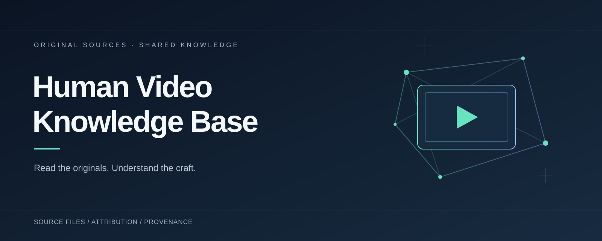

# Human Video Knowledge Base
## 人类视频知识库

**从原始资料出发，理解影像创作。**  
**Read the originals. Understand the craft.**

这是一个持续建设的公开视频知识资料库。我们保留精选上游文档和源文件的原始字节、作者署名、许可证与可追溯出处，让学习者直接阅读原作，而不是用重新编写的教程替代它们。

This growing public collection brings selected original documents and source files together with attribution, applicable licenses and precise provenance.

[查看资料 / Explore sources](upstream/) · [收录状态 / Collection status](COLLECTION.json) · [初始来源 / Initial sources](SOURCES.json) · [后续批次 / Batches](batches/)

### 如何阅读

1. 从来源清单确认作者、上游链接、固定版本及具体收录范围。
2. 区分“完整的指定文档”与 README、局部实现、许可文件等辅助材料。完整文件不等于完整项目。
3. 阅读原文件及其适用许可。需要使用关联素材、模型、依赖或训练数据时，另行核对权利。
4. 通过 `SHA256SUMS.txt` 核对所收录源文件的字节完整性。

### 当前状态与边界

- **持续收录中，不是完整百科。** 最新数量和各批覆盖范围以 `COLLECTION.json` 及批次清单为准。
- 只纳入有明确适用权利依据的文件；能公开访问或免费阅读，不等于允许再分发。
- 上游版权、许可和声明继续有效，本仓库不统一重新许可第三方作品。
- 收录不等于已经运行、完成技术审计、验证性能、安全或取得训练授权；上游安装与执行指令未被运行。
- 不收录私人研究、内部方案、运营记录或账号信息；不以新增教学文章替代原作。

---

## Original materials, provenance & rights

This repository preserves complete selected upstream source documents and files as unchanged bytes, with their original licenses, attribution and precise provenance. It does not replace original materials with newly written tutorials.

- `upstream/` contains retained original documents and source files.
- `license-only/` preserves previously collected license documents. A license document alone is not a complete project or permission to redistribute its unprovided contents. Later batches can explicitly reuse an identical retained license.
- `SOURCES.json` records the initial collection; `batches/*/SOURCES.json` records subsequent verified acquisitions and their exact coverage. A canonical file marked complete is distinguished from a README, selected implementation or other supporting file.
- `COLLECTION.json` gives cumulative counts and links to every manifest. `SHA256SUMS.txt` verifies retained bytes.

Acquisition is incomplete. Public access, free reading or an “open source” label alone is not treated as redistribution permission. Only files with explicit applicable rights evidence are included. Unresolved grants, conflicting notices and access restrictions are not bypassed. Original copyright, licenses and notices remain applicable; this repository does not relicense third-party works. Referenced media, models, assets, dependencies, trademarks and external links are not automatically included or cleared.

All files are preserved for reading. Upstream instructions and installation commands were not executed. Preservation does not establish full technical review, safe execution, measured performance or training-rights clearance. Private research, internal plans, operational records and account information are excluded. No new teaching articles are included.
